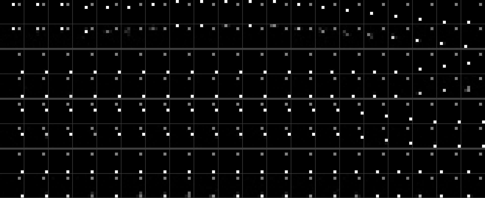

# dreamer-core

[](https://github.com/GonzaloFuentes1/dreamer-core/actions/workflows/ci.yml)

Small, readable PyTorch implementations of the mechanisms that make DreamerV3-style world
models train robustly: the RSSM with discrete latents, unimix and straight-through sampling,
KL balancing with free bits, symlog two-hot heads, lambda-returns, percentile return
normalisation and an imagination actor-critic. Each mechanism lives in its own module and is
paired with a unit test that checks the property it is supposed to have (an exact inverse, a
gradient that reaches only the intended parameters, parity with an independent reference),
rather than relying on a learning curve to reveal a mistake. A pure-NumPy toy environment and
a CPU training script show the pieces working together.

## What it is and what it is not

It is:

- a set of building blocks with invariant tests, intended as a reference when implementing or
  debugging a Dreamer-style agent;
- CPU-friendly: CI uses CPU-only torch and the full suite of 67 tests ran in 7.7 s on a GitHub
  ubuntu-latest runner;
- a small end-to-end world-model run on a toy image environment, with the measured numbers
  and the script that produced them.

It is not:

- a full agent that reproduces DreamerV3 benchmark results. There is no environment
  interaction loop, replay buffer with state carry-over, or Atari/DMC/Minecraft setup. For
  that, use the official implementation, [danijar/dreamerv3](https://github.com/danijar/dreamerv3).
- a DreamerV4 implementation. For a re-implementation of DreamerV4 see
  [GonzaloFuentes1/dreamer4](https://github.com/GonzaloFuentes1/dreamer4).

## Quickstart

```bash
git clone https://github.com/GonzaloFuentes1/dreamer-core.git
cd dreamer-core
uv venv --python 3.12 .venv
uv pip install --python .venv torch --index-url https://download.pytorch.org/whl/cpu
uv pip install --python .venv -e ".[dev,toy]"
source .venv/bin/activate      # .venv/Scripts/activate on Windows

python -m pytest               # invariant tests
ruff check . && ruff format --check .
python scripts/train_toy.py --seed 0 --steps 3000   # toy world model on CPU, writes to runs/
```

Minimal use of the blocks:

```python
import torch
from dreamer_core.rssm import RSSM, RSSMConfig
from dreamer_core.losses import kl_balance

rssm = RSSM(RSSMConfig(action_dim=4, embed_dim=256))  # 32 x 32 categorical latents
embed = torch.randn(8, 16, 256)  # (batch, time, embed)
prev_action = torch.zeros(8, 16, 4)
is_first = torch.zeros(8, 16)
is_first[:, 0] = 1
post, prior = rssm.observe(embed, prev_action, is_first)
kl = kl_balance(post.logits, prior.logits)  # dyn 0.5, rep 0.1, free 1 nat
imagined = rssm.imagine(post[-1], torch.zeros(8, 15, 4))  # open-loop prior rollout
```

## Layout

| Module | Contents |
| --- | --- |
| `dreamer_core/symlog.py` | `symlog`, `symexp`, `TwoHot` encoder/decoder and loss |
| `dreamer_core/distributions.py` | unimix, straight-through one-hot sampling, categorical KL and entropy |
| `dreamer_core/nets.py` | LayerNorm MLP (optional zero-initialised output), LayerNorm GRU cell |
| `dreamer_core/rssm.py` | `RSSM`: `img_step`, `obs_step`, `observe`, `imagine` |
| `dreamer_core/losses.py` | `kl_balance`: dynamics/representation split with free bits |
| `dreamer_core/returns.py` | `lambda_return`, `ReturnNormalizer` |
| `dreamer_core/actor_critic.py` | REINFORCE actor, two-hot critic with slow EMA target, imagination rollout |
| `dreamer_core/world_model.py` | conv encoder/decoder, reward and continuation heads, world-model loss |
| `dreamer_core/toy/` | `DotGrid` environment, data collection, seeded training and evaluation |
| `scripts/train_toy.py` | trains and evaluates the toy world model; writes a JSON record and two images to `runs/` by default |

## The mechanisms, why they exist, and how each is tested

### 1. Symlog and two-hot heads

$$\mathrm{symlog}(x) = \mathrm{sign}(x)\,\ln(1 + |x|), \qquad \mathrm{symexp}(x) = \mathrm{sign}(x)\,(e^{|x|} - 1)$$

Rewards and values have unknown scale. A squared error on raw targets lets large targets
dominate the gradient, so DreamerV3 predicts them as a categorical distribution over 255 bins
evenly spaced in symlog space on [-20, 20] (exponentially spaced in raw space). A target `y`
is encoded as a *two-hot* vector: weight split between the two bins around `symlog(y)` by
linear interpolation; the prediction is `symexp(sum_k p_k b_k)`. The cross-entropy gradient
with respect to the logits is `softmax(l) - twohot(y)`, whose size does not depend on the
magnitude of `y`.

Tests (`tests/test_symlog.py`): `symexp(symlog(x)) == x` to 1e-12 relative error over 15
orders of magnitude; two-hot weights match an independent loop-based reference; weights sum
to one and sit on at most two adjacent bins; `decode(encode(y)) == y`; out-of-range targets
clip to the edge bins; the loss gradient equals `softmax - twohot`; for targets of 1, 1e3 and
1e6 the target part of that gradient is a distribution on at most two adjacent bins and the
gradient L1 norm changes by less than 1%, while the gradient of a squared error on the raw
target grows by a factor of 1e6.

### 2. Discrete latents: unimix and straight-through sampling

$$p = (1 - u)\,\mathrm{softmax}(l) + u / K, \qquad u = 0.01$$

Every class keeps probability at least `u / K`, which bounds the KL between any two latent
distributions by `log(K / u)` and prevents KL spikes from overconfident priors. Samples are
exact one-hot vectors in the forward pass with the straight-through gradient
`one_hot + (p - sg(p))`, so reconstruction gradients reach the encoder through the discrete
bottleneck.

Tests (`tests/test_distributions.py`): every probability is at least `u / K` even for logits
of +-1e4; the KL between two opposite one-hot-like distributions drops from above 1e3 nats to
below `log(K / u)`; the forward value is exactly one-hot; the gradient of the sample equals
the softmax Jacobian `diag(p) - p p^T` (closed form, float64, atol 1e-14); empirical
frequencies from 2e5 draws are within four binomial standard deviations of `p`; KL and entropy
match `torch.distributions`. Writing the estimator as `one_hot + p - sg(p)` instead rounds the
forward value to `1 - eps`; the exact-one-hot test caught this.

### 3. RSSM

$$h_t = f_\phi(h_{t-1}, z_{t-1}, a_{t-1}), \quad z_t \sim q_\phi(z_t \mid h_t, e_t), \quad \hat z_t \sim p_\phi(\hat z_t \mid h_t)$$

The deterministic GRU state carries information over many steps without sampling noise; the
stochastic state (32 categoricals of 32 classes by default, configurable) represents what
cannot be predicted. The GRU uses LayerNorm on its gates and an update-gate bias of -1, which
favours keeping memory early in training. `observe` filters a sequence and resets the state
where `is_first` is set; `imagine` rolls the prior forward from actions alone.

Tests (`tests/test_rssm.py`): shapes for several latent layouts; unimix floor holds for both
heads with extreme logits; the priors produced by `observe` are bitwise equal to a one-step
`img_step` from the previous posterior; `imagine` equals a loop of `img_step` with the same
generator; with `is_first` set mid-sequence, two sequences with different histories produce
identical states from the boundary on; gradients reach the encoder embedding through the
sampled latents.

### 4. KL balancing and free bits

$$\mathcal{L}_{dyn} = \max\big(1, \mathrm{KL}[\mathrm{sg}(q) \,\|\, p]\big), \quad \mathcal{L}_{rep} = \max\big(1, \mathrm{KL}[q \,\|\, \mathrm{sg}(p)]\big), \quad \mathcal{L} = 0.5\,\mathcal{L}_{dyn} + 0.1\,\mathcal{L}_{rep}$$

A single KL would pull posterior and prior together at the same rate, letting the posterior
collapse towards a poor prior. The split trains the prior to predict the posterior faster
than the posterior is regularised towards the prior. Free bits stop optimising a KL that is
already below 1 nat (summed over latents, per batch and time element), leaving capacity to
the reconstruction loss.

Tests (`tests/test_losses.py`): on raw logits, the dynamics term has zero gradient with
respect to the posterior and the representation term zero gradient with respect to the
prior; inside the RSSM, the dynamics term reaches the prior head but not the posterior head
or the encoder, and the representation term reaches the posterior head and the encoder but
not the prior head; with equal scales and no free bits the split reproduces the gradient of
a plain KL exactly; below 1 nat the loss is constant and its gradient is zero; clipping is
per element. One test documents a subtlety: the stop-gradient applies to the KL inputs only,
so over several steps the dynamics loss *does* reach the encoder through the posterior
samples that feed the next recurrent state (as in DreamerV3). The routing guarantee is per
time step.

### 5. Lambda-returns

$$R^\lambda_t = r_t + \gamma\, c_t \big((1 - \lambda)\, v_{t+1} + \lambda R^\lambda_{t+1}\big), \qquad R^\lambda_T = v_T$$

Imagined rollouts are short (15 steps by default), so returns must bootstrap from the critic;
lambda trades the bias of bootstrapping against the variance of long reward sums, and the
continuation flag `c_t` cuts the bootstrap at predicted terminals.

Tests (`tests/test_returns.py`): a three-step example with a terminal, computed by hand in
the test; parity with an independent GAE formulation (Schulman et al., `R = A^GAE + V`) for
four (gamma, lambda) pairs; lambda = 0 gives the one-step TD target and lambda = 1 the
discounted Monte Carlo return plus the discounted bootstrap.

### 6. Percentile return normalisation

$$S = \mathrm{EMA}\big(\mathrm{Per}(R, 95) - \mathrm{Per}(R, 5)\big), \qquad A_t = \frac{R^\lambda_t - v_t}{\max(1, S)}$$

Dividing advantages by the return spread lets one entropy coefficient (3e-4) work across
reward scales. The `max(1, S)` floor avoids amplifying noise when returns are small, which a
standard-deviation normalisation would do under sparse rewards; percentiles make the scale
robust to outliers. The two percentiles are tracked with separate EMAs (decay 0.99).

Tests: exact EMA values after three updates; returns with spread below 1 are left unscaled;
returns with spread 9e4 are divided by it; 0.5% outliers of 1e6 move the scale by less than
2%.

### 7. Actor-critic in imagination

$$\mathcal{L}_{actor} = -\,\mathrm{sg}(A_t)\,\ln \pi(a_t \mid s_t) - \eta\, \mathrm{H}[\pi(\cdot \mid s_t)], \quad \eta = 3 \times 10^{-4}$$

For discrete actions, REINFORCE gives unbiased gradients without differentiating through the
learned dynamics, so trajectories are imagined under `no_grad`. The critic uses the same
two-hot head as the reward predictor, its output layer is zero-initialised (initial value
exactly zero up to float rounding), and it is regularised towards a slow EMA copy of itself
(decay 0.98). Steps after a predicted terminal are down-weighted by the cumulative product of
continuation probabilities.

Tests (`tests/test_actor_critic.py`): the REINFORCE gradient matches the closed form
`-A (onehot(a) - p)`; no gradient flows into the advantage; with zero advantage the entropy
bonus increases entropy; the EMA update matches its formula; a two-armed bandit is solved
(probability of the better arm above 0.95 after 150 updates); the imagination losses produce
gradients in the actor and critic only, never in the RSSM, the reward and continuation heads
or the slow critic.

## Toy world model: DotGrid

`DotGrid` is a pure-NumPy environment: a 2x2-pixel dot moves on an 8x8 grid rendered as a
16x16 image, with five actions (no-op and four moves, clipped at the walls). A goal cell is
drawn at half intensity; reaching it gives reward 1 and ends the episode. Training data is a
50,000-step stream from a sticky random policy. `scripts/train_toy.py` trains the world model
(660,161 parameters) and then evaluates open-loop prediction on held-out sequences from a
different seed: 5 observed context frames, then 20 frames imagined from the actions alone.

Measured with `python scripts/train_toy.py --seed 0 --steps 3000` (single run, seed 0) on a
Windows 11 laptop with an Intel Core i7-13620H, CPU only, torch 2.14.1+cpu with 10 threads.
Training took 1550 s of wall time (1586 s including data collection and evaluation); the
machine was running other jobs at the same time, so treat the timing as an upper bound. All
numbers below are copied from [`results/wm_toy.json`](results/wm_toy.json), which also holds
the loss curve logged every 25 steps and the full configuration.

Training losses (per sequence element; `image` is the summed squared error over 256 pixels,
`kl` the unclipped KL summed over latents):

| step | total | image | reward | cont | kl |
| ---: | ---: | ---: | ---: | ---: | ---: |
| 1 | 158.69 | 151.43 | 5.54 | 0.657 | 1.77 |
| 1000 | 4.405 | 3.759 | 0.016 | 0.014 | 0.91 |
| 2000 | 1.378 | 0.209 | 0.0002 | 0.0000 | 1.65 |
| 3000 | 0.903 | 0.050 | 0.0001 | 0.0000 | 0.97 |

The loss sits on a plateau until roughly step 1000 (the decoder draws the static background
and goal, and the KL stays near the 1-nat free-bits floor), then drops once the latent starts
to encode the dot position.

Open-loop prediction on 64 held-out sequences (5 context frames, then 20 frames imagined from
actions only). The baseline repeats the last context frame. Dot-cell accuracy is the fraction
of frames where the brightest 2x2 block of the prediction is the true dot cell.

| metric (mean over 20 imagined steps) | world model | copy last frame |
| --- | ---: | ---: |
| pixel MSE | 0.0018 | 0.0227 |
| dot-cell accuracy | 0.910 | 0.273 |
| dot-cell accuracy at imagined step 1 | 0.969 | 0.594 |
| dot-cell accuracy at imagined step 20 | 0.859 | 0.141 |



Four held-out sequences, imagined steps 1 to 20 from left to right. In each pair of rows the
upper row is the ground truth and the lower row is the world model's open-loop prediction.
An animated version (ground truth left, prediction right) is in
[`assets/wm_toy_openloop.gif`](assets/wm_toy_openloop.gif). Both images are written by the
script.

This is a sanity check that the components train together, not a benchmark: one seed, one
small environment, a random-policy dataset, and no behaviour learning in the loop.

## How it is verified

- **Parity with independent references**: two-hot weights against a loop-based
  implementation, lambda-returns against GAE, KL and entropy against `torch.distributions`,
  straight-through gradients against the closed-form softmax Jacobian, REINFORCE gradients
  against the score-function formula, EMA updates against their formula.
- **Gradient routing**: explicit `torch.autograd.grad` checks that each loss term reaches
  exactly the parameters it should (KL balancing, actor-critic isolation from the world model).
- **Exact identities**: symlog/symexp inverse, decode(encode(y)), observe/imagine consistency,
  `is_first` resets, hand-computed returns.
- **Determinism**: two training runs with the same seed give bitwise-identical losses and
  parameters on CPU; a different seed gives different ones (`tests/test_toy.py`).
- **Lint and CI**: `ruff check` and `ruff format --check`, and `pytest` on Python 3.11 and 3.12
  with CPU-only torch on every pull request.

## Design notes

- **Time convention.** Batches follow the DreamerV3 replay layout: `prev_action[t]` is the
  action that led to observation `t`, `reward[t]` and `cont[t]` describe arriving at it. In
  imagination, the reward and continuation of transition `t -> t+1` are predicted from the
  features of state `t+1`.
- **Initial state.** The RSSM starts from zeros and every training window starts with
  `is_first = 1`. The reference implementation uses a learned initial state and can carry
  latent state across replay chunks; both are omitted here for simplicity.
- **Returns use the online critic** (detached); the slow critic only provides the
  regularisation target.
- **Image loss** is a summed squared error on pixels in [0, 1]; symlog is used for the reward
  and value targets.
- **Dedicated generators.** Latent and action sampling take an explicit `torch.Generator`, so
  unrelated random calls elsewhere do not shift the samples; this is what makes the
  determinism test meaningful.
- **Sizes.** Defaults in `RSSMConfig` follow the DreamerV3 latent layout (32 x 32); the toy run
  uses 16 x 16 latents and a 128-unit deterministic state so it fits in a few CPU minutes.

## References

- D. Hafner, J. Pasukonis, J. Ba, T. Lillicrap. *Mastering Diverse Domains through World
  Models* (DreamerV3). [arXiv:2301.04104](https://arxiv.org/abs/2301.04104)
- D. Hafner, T. Lillicrap, M. Norouzi, J. Ba. *Mastering Atari with Discrete World Models*
  (DreamerV2). [arXiv:2010.02193](https://arxiv.org/abs/2010.02193)
- D. Hafner, T. Lillicrap, J. Ba, M. Norouzi. *Dream to Control: Learning Behaviors by Latent
  Imagination* (Dreamer). [arXiv:1912.01603](https://arxiv.org/abs/1912.01603)
- Official DreamerV3 implementation: [github.com/danijar/dreamerv3](https://github.com/danijar/dreamerv3)
- J. Schulman, P. Moritz, S. Levine, M. Jordan, P. Abbeel. *High-Dimensional Continuous Control
  Using Generalized Advantage Estimation*. [arXiv:1506.02438](https://arxiv.org/abs/1506.02438)
- DreamerV4 re-implementation by the same author:
  [github.com/GonzaloFuentes1/dreamer4](https://github.com/GonzaloFuentes1/dreamer4)

## License

MIT. See [LICENSE](LICENSE). Citation metadata is in [CITATION.cff](CITATION.cff).
